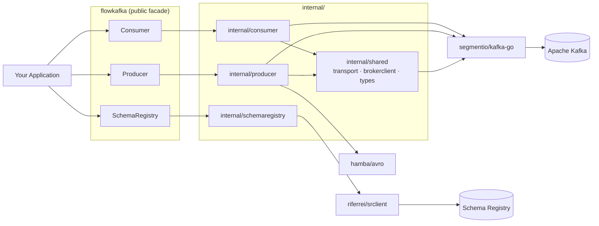

# flowkafka

**A production-ready Kafka toolkit for Go — clean interfaces over [segmentio/kafka-go](https://github.com/segmentio/kafka-go), with JSON and Avro producers, consumer groups, and Schema Registry support.**

[](https://pkg.go.dev/github.com/mauricioromagnollo/flowkafka)
[](https://github.com/mauricioromagnollo/flowkafka/actions/workflows/ci.yaml)
[](https://goreportcard.com/report/github.com/mauricioromagnollo/flowkafka)
[](https://go.dev/dl/)
[](https://github.com/mauricioromagnollo/flowkafka/releases)
[](LICENSE)
[](CONTRIBUTING.md)

---

## Table of Contents

- [Features](#features)
- [Requirements](#requirements)
- [Installation](#installation)
- [Quick Start](#quick-start)
- [Usage](#usage)
  - [Producer (JSON)](#producer-json)
  - [Producer (Avro + Schema Registry)](#producer-avro--schema-registry)
  - [Consumer (handler-based)](#consumer-handler-based)
  - [Consumer (channel-based)](#consumer-channel-based)
  - [Validating connections](#validating-connections)
  - [Graceful shutdown](#graceful-shutdown)
  - [SASL/TLS authentication](#sasltls-authentication)
- [Configuration Reference](#configuration-reference)
- [API Reference](#api-reference)
- [Error Handling](#error-handling)
- [Testing](#testing)
- [Development](#development)
- [Architecture](#architecture)
- [Roadmap](#roadmap)
- [Contributing](#contributing)
- [Security](#security)
- [License](#license)
- [Acknowledgements](#acknowledgements)

---

## Features

- **JSON producer** — `Publish` marshals any Go value to JSON and writes it to a topic.
- **Avro producer** — `PublishAvro` serializes with [hamba/avro](https://github.com/hamba/avro) and frames the payload in the Confluent wire format (`[magic byte][schema id][avro payload]`).
- **Two consumption styles** — a blocking handler loop (`Consume`) or a channel-based fan-out (`ConsumeMessages`).
- **Consumer groups** — built on kafka-go's group-aware reader via `GroupID`.
- **Manual commit semantics** — messages are committed only *after* your handler returns `nil`, giving you at-least-once delivery.
- **SASL/PLAIN + TLS** — set a password and both the producer transport and the consumer dialer switch to SASL/PLAIN over TLS (min TLS 1.2) automatically.
- **Confluent-compatible Schema Registry** — create, fetch, and validate schemas through [riferrei/srclient](https://github.com/riferrei/srclient).
- **Connection validation** — `ValidateConnection` fails fast at startup if the broker is unreachable or the topic does not exist.
- **Mockable by design** — `Producer`, `Consumer`, and `SchemaRegistry` are interfaces, so your code depends on abstractions and your tests need no live Kafka.

## Requirements

- **Go 1.26.0** or newer (see [`.go-version`](.go-version)).
- A reachable Apache Kafka cluster.
- *(Optional)* A Confluent-compatible Schema Registry, required only for `PublishAvro`.

## Installation

```sh
go get github.com/mauricioromagnollo/flowkafka
```

```go
import "github.com/mauricioromagnollo/flowkafka"
```

## Quick Start

Produce a JSON message and consume it back:

```go
package main

import (
	"context"
	"fmt"
	"log"

	"github.com/mauricioromagnollo/flowkafka"
)

func main() {
	ctx := context.Background()
	brokers := []string{"localhost:9092"}

	producer := flowkafka.NewProducer(flowkafka.ProducerConfig{
		Brokers:   brokers,
		TopicName: "user-events",
	})
	defer producer.Close()

	if err := producer.ValidateConnection(ctx); err != nil {
		log.Fatalf("producer: %v", err)
	}

	if err := producer.Publish(ctx, []byte("user-42"), map[string]any{
		"event": "signup",
		"email": "ada@example.com",
	}); err != nil {
		log.Fatalf("publish: %v", err)
	}

	consumer := flowkafka.NewConsumer(flowkafka.ConsumerConfig{
		Brokers:   brokers,
		GroupID:   "user-events-worker",
		TopicName: "user-events",
	})
	defer consumer.Close()

	err := consumer.Consume(ctx, func(msg flowkafka.Message) error {
		fmt.Printf("key=%s value=%s partition=%d offset=%d\n",
			msg.Key, msg.Value, msg.Partition, msg.Offset)
		return nil // returning nil commits the message
	})
	if err != nil {
		log.Fatalf("consume: %v", err)
	}
}
```

## Usage

### Producer (JSON)

`Publish` marshals the message with `encoding/json` and writes it to the configured topic. The key may be `nil`, in which case the balancer distributes messages across partitions.

```go
package main

import (
	"context"
	"log"

	"github.com/mauricioromagnollo/flowkafka"
)

type OrderCreated struct {
	OrderID string  `json:"order_id"`
	Total   float64 `json:"total"`
}

func main() {
	producer := flowkafka.NewProducer(flowkafka.ProducerConfig{
		Brokers:      []string{"localhost:9092"},
		TopicName:    "orders",
		RequiredAcks: flowkafka.RequiredAcksAll,
	})
	defer producer.Close()

	event := OrderCreated{OrderID: "ord_1001", Total: 149.90}

	if err := producer.Publish(context.Background(), []byte(event.OrderID), event); err != nil {
		log.Fatalf("publish: %v", err)
	}
}
```

### Producer (Avro + Schema Registry)

`PublishAvro` looks up the latest schema for the subject `"<TopicName>-value"`, parses it, marshals your value with `hamba/avro`, and prefixes the Confluent envelope. It returns an error if no Schema Registry is configured — you can check up front with `HasSchemaRegistry()`.

Struct fields are mapped by their `avro` tags.

```go
package main

import (
	"context"
	"log"

	"github.com/mauricioromagnollo/flowkafka"
)

type OrderCreated struct {
	OrderID string  `avro:"order_id"`
	Total   float64 `avro:"total"`
}

const orderSchema = `{
  "type": "record",
  "name": "OrderCreated",
  "fields": [
    {"name": "order_id", "type": "string"},
    {"name": "total", "type": "double"}
  ]
}`

func main() {
	ctx := context.Background()

	registry := flowkafka.NewSchemaRegistry(flowkafka.SchemaRegistryConfig{
		Endpoint: "http://localhost:8081",
	})

	if err := registry.ValidateConnection(); err != nil {
		log.Fatalf("schema registry: %v", err)
	}

	// Registers the subject if it does not exist yet, or adds a new version
	// when the schema differs from the latest one.
	if err := registry.CreateNewSchema("orders-value", orderSchema, flowkafka.SchemaType("AVRO")); err != nil {
		log.Fatalf("create schema: %v", err)
	}

	producer := flowkafka.NewProducer(flowkafka.ProducerConfig{
		Brokers:        []string{"localhost:9092"},
		TopicName:      "orders",
		SchemaRegistry: registry,
	})
	defer producer.Close()

	if !producer.HasSchemaRegistry() {
		log.Fatal("producer was built without a schema registry")
	}

	event := OrderCreated{OrderID: "ord_1001", Total: 149.90}

	if err := producer.PublishAvro(ctx, []byte(event.OrderID), event); err != nil {
		log.Fatalf("publish avro: %v", err)
	}
}
```

> **Note:** `SchemaType` is a string type. Valid values are `"AVRO"`, `"JSON"`, and `"PROTOBUF"`.

### Consumer (handler-based)

`Consume` blocks in a fetch loop. Each message is handed to your handler; the offset is committed **only** after the handler returns `nil`. If the handler returns an error, the loop stops and the error is returned wrapped — the message is *not* committed, so it will be redelivered.

```go
package main

import (
	"context"
	"encoding/json"
	"log"

	"github.com/mauricioromagnollo/flowkafka"
)

type OrderCreated struct {
	OrderID string  `json:"order_id"`
	Total   float64 `json:"total"`
}

func main() {
	consumer := flowkafka.NewConsumer(flowkafka.ConsumerConfig{
		Brokers:   []string{"localhost:9092"},
		GroupID:   "orders-worker",
		TopicName: "orders",
	})
	defer consumer.Close()

	err := consumer.Consume(context.Background(), func(msg flowkafka.Message) error {
		var event OrderCreated
		if err := json.Unmarshal(msg.Value, &event); err != nil {
			// Returning an error stops the loop and skips the commit.
			// Log and return nil instead if you prefer to drop poison messages.
			log.Printf("skipping malformed message at offset %d: %v", msg.Offset, err)
			return nil
		}

		log.Printf("order %s totalling %.2f", event.OrderID, event.Total)
		return nil
	})
	if err != nil {
		log.Fatalf("consume: %v", err)
	}
}
```

### Consumer (channel-based)

`ConsumeMessages` pushes every fetched message into a channel you own. It returns `nil` when the context is canceled, and commits each message after it has been accepted by the channel. **You** are responsible for closing the channel once `ConsumeMessages` returns.

```go
package main

import (
	"context"
	"log"
	"sync"

	"github.com/mauricioromagnollo/flowkafka"
)

func main() {
	consumer := flowkafka.NewConsumer(flowkafka.ConsumerConfig{
		Brokers:   []string{"localhost:9092"},
		GroupID:   "orders-worker",
		TopicName: "orders",
	})
	defer consumer.Close()

	messages := make(chan flowkafka.Message)

	var wg sync.WaitGroup
	wg.Add(1)
	go func() {
		defer wg.Done()
		for msg := range messages {
			log.Printf("key=%s value=%s", msg.Key, msg.Value)
		}
	}()

	err := consumer.ConsumeMessages(context.Background(), messages)
	close(messages)
	wg.Wait()

	if err != nil {
		log.Fatalf("consume messages: %v", err)
	}
}
```

> **Delivery semantics:** the offset is committed as soon as the message is handed to the channel, not after your worker finishes processing it. If the commit must wait for successful processing, use the handler-based `Consume`.

### Validating connections

Both Kafka clients expose `ValidateConnection`, which fetches cluster metadata and asserts that the configured topic exists. `SchemaRegistry.ValidateConnection` lists subjects instead and takes no context.

```go
ctx, cancel := context.WithTimeout(context.Background(), 10*time.Second)
defer cancel()

if err := producer.ValidateConnection(ctx); err != nil {
	log.Fatalf("kafka producer is not healthy: %v", err)
}

if err := consumer.ValidateConnection(ctx); err != nil {
	log.Fatalf("kafka consumer is not healthy: %v", err)
}

if err := registry.ValidateConnection(); err != nil {
	log.Fatalf("schema registry is not healthy: %v", err)
}
```

This is a good fit for a startup readiness check or a `/health` endpoint.

### Graceful shutdown

Cancel the context on `SIGINT`/`SIGTERM`; the consume loop unwinds and returns a wrapped `context.Canceled`.

```go
package main

import (
	"context"
	"errors"
	"log"
	"os"
	"os/signal"
	"syscall"

	"github.com/mauricioromagnollo/flowkafka"
)

func main() {
	ctx, stop := signal.NotifyContext(context.Background(), os.Interrupt, syscall.SIGTERM)
	defer stop()

	consumer := flowkafka.NewConsumer(flowkafka.ConsumerConfig{
		Brokers:   []string{"localhost:9092"},
		GroupID:   "orders-worker",
		TopicName: "orders",
	})

	err := consumer.Consume(ctx, func(msg flowkafka.Message) error {
		log.Printf("processing offset %d", msg.Offset)
		return nil
	})

	if err != nil && !errors.Is(err, context.Canceled) {
		log.Printf("consumer stopped with error: %v", err)
	}

	if err := consumer.Close(); err != nil {
		log.Printf("failed to close consumer: %v", err)
	}

	log.Println("shutdown complete")
}
```

### SASL/TLS authentication

Setting `SaslPassword` to a non-empty value enables SASL/PLAIN with TLS (minimum version 1.2) on the producer transport, the consumer dialer, and the metadata client. Leave it empty for plaintext local development.

```go
producer := flowkafka.NewProducer(flowkafka.ProducerConfig{
	Brokers:      []string{"pkc-xxxxx.us-east-1.aws.confluent.cloud:9092"},
	TopicName:    "orders",
	SaslUsername: os.Getenv("KAFKA_API_KEY"),
	SaslPassword: os.Getenv("KAFKA_API_SECRET"),
	RequiredAcks: flowkafka.RequiredAcksAll,
})

consumer := flowkafka.NewConsumer(flowkafka.ConsumerConfig{
	Brokers:      []string{"pkc-xxxxx.us-east-1.aws.confluent.cloud:9092"},
	GroupID:      "orders-worker",
	TopicName:    "orders",
	SaslUsername: os.Getenv("KAFKA_API_KEY"),
	SaslPassword: os.Getenv("KAFKA_API_SECRET"),
})

registry := flowkafka.NewSchemaRegistry(flowkafka.SchemaRegistryConfig{
	Endpoint:     os.Getenv("SCHEMA_REGISTRY_URL"),
	SaslUsername: os.Getenv("SCHEMA_REGISTRY_KEY"),
	SaslPassword: os.Getenv("SCHEMA_REGISTRY_SECRET"),
})
```

> Schema Registry credentials are only applied when **both** `SaslUsername` and `SaslPassword` are non-empty.

## Configuration Reference

### `ProducerConfig`

| Field | Type | Required | Default | Description |
| --- | --- | --- | --- | --- |
| `Brokers` | `[]string` | Yes | — | Kafka broker addresses (`host:port`). |
| `TopicName` | `string` | Yes | — | Topic to produce to. Also derives the Avro subject `<TopicName>-value`. |
| `SaslUsername` | `string` | No | `""` | SASL/PLAIN username. |
| `SaslPassword` | `string` | No | `""` | SASL/PLAIN password. A non-empty value enables SASL/PLAIN over TLS 1.2+. |
| `SchemaRegistry` | `SchemaRegistry` | No | `nil` | Schema Registry client. Required for `PublishAvro`. |
| `MaxAttempts` | `int` | No | `10` | Maximum write attempts before the write fails. |
| `BatchTimeout` | `time.Duration` | No | `1s` | How long to wait before flushing a partial batch. |
| `WriteTimeout` | `time.Duration` | No | `10s` | Timeout for a single write request to the broker. |
| `ReadTimeout` | `time.Duration` | No | `10s` | Timeout for reading the broker's response. |
| `RequiredAcks` | `RequiredAcks` | No | `RequiredAcksNone` (`0`) | Acknowledgement level. Set explicitly to `RequiredAcksAll` for durability. |
| `ClientTimeout` | `time.Duration` | No | none | Timeout applied to metadata requests made by `ValidateConnection`. When zero, only the caller's context bounds the request. |

> **Defaults caveat:** the zero-value fallbacks above come from the underlying `kafka-go` writer, which applies them when a field is left at zero. The `default:"..."` struct tags in the source are documentary only — nothing reads them at runtime. In particular, **`RequiredAcks` effectively defaults to `RequiredAcksNone` (fire-and-forget)**, so set it explicitly if you need delivery guarantees.

**`RequiredAcks` values**

| Constant | Value | Behaviour |
| --- | --- | --- |
| `RequiredAcksNone` | `0` | Do not wait for any acknowledgement. Lowest latency, highest risk of loss. |
| `RequiredAcksOne` | `1` | Wait for the leader broker only. Balanced. |
| `RequiredAcksAll` | `-1` | Wait for all in-sync replicas. Most durable, highest latency. |

### `ConsumerConfig`

| Field | Type | Required | Default | Description |
| --- | --- | --- | --- | --- |
| `Brokers` | `[]string` | Yes | — | Kafka broker addresses (`host:port`). |
| `TopicName` | `string` | Yes | — | Topic to consume from. |
| `GroupID` | `string` | Yes | — | Consumer group ID. Enables group coordination and offset commits. |
| `SaslUsername` | `string` | No | `""` | SASL/PLAIN username. |
| `SaslPassword` | `string` | No | `""` | SASL/PLAIN password. A non-empty value enables SASL/PLAIN over TLS 1.2+. |

> The consumer dials with a 10s timeout and dual-stack (IPv4/IPv6) resolution. These are not configurable yet.

### `SchemaRegistryConfig`

| Field | Type | Required | Default | Description |
| --- | --- | --- | --- | --- |
| `Endpoint` | `string` | Yes | — | Base URL of the Schema Registry, e.g. `http://localhost:8081`. |
| `SaslUsername` | `string` | No | `""` | Basic-auth username. Applied only if `SaslPassword` is also set. |
| `SaslPassword` | `string` | No | `""` | Basic-auth password. Applied only if `SaslUsername` is also set. |

### `Message`

| Field | Type | Description |
| --- | --- | --- |
| `Key` | `[]byte` | Message key. |
| `Value` | `[]byte` | Raw message payload. |
| `Headers` | `any` | Kafka record headers as returned by the underlying reader. |
| `Partition` | `int` | Partition the message was read from. |
| `Offset` | `int64` | Offset within the partition. |

## API Reference

Full documentation on [pkg.go.dev](https://pkg.go.dev/github.com/mauricioromagnollo/flowkafka).

### Constructors

| Function | Returns |
| --- | --- |
| `NewProducer(config ProducerConfig) Producer` | A Kafka producer. |
| `NewConsumer(config ConsumerConfig) Consumer` | A Kafka consumer bound to a consumer group. |
| `NewSchemaRegistry(config SchemaRegistryConfig) SchemaRegistry` | A Schema Registry client. |

### `Producer`

| Method | Description |
| --- | --- |
| `ValidateConnection(ctx context.Context) error` | Fetches metadata and verifies the topic exists. |
| `Publish(ctx context.Context, key []byte, msg any) error` | JSON-marshals `msg` and writes it. |
| `PublishAvro(ctx context.Context, key []byte, msg any) error` | Avro-serializes `msg` in the Confluent wire format and writes it. |
| `HasSchemaRegistry() bool` | Reports whether a Schema Registry was configured. |
| `Close() error` | Flushes and closes the underlying writer. |

### `Consumer`

| Method | Description |
| --- | --- |
| `Consume(ctx context.Context, handler func(msg Message) error) error` | Blocking loop; commits after the handler returns `nil`. |
| `ConsumeMessages(ctx context.Context, msgsChan chan<- Message) error` | Blocking loop; forwards messages to a channel. Returns `nil` on context cancellation. |
| `ValidateConnection(ctx context.Context) error` | Fetches metadata and verifies the topic exists. |
| `Close() error` | Closes the underlying reader and leaves the consumer group. |

### `SchemaRegistry`

| Method | Description |
| --- | --- |
| `GetLatestSchema(subject string) (*srclient.Schema, error)` | Returns the latest registered schema for a subject. |
| `CreateNewSchema(subject, schema string, schemaType SchemaType) error` | Registers a schema, or a new version if it differs from the latest. No-op if identical. |
| `ValidateConnection() error` | Lists subjects to verify connectivity and credentials. |

### Types and constants

| Name | Kind | Notes |
| --- | --- | --- |
| `Message` | `struct` | Message received by the consumer. |
| `ProducerConfig`, `ConsumerConfig`, `SchemaRegistryConfig` | `struct` | Client configuration. |
| `RequiredAcks` | `int` | With `RequiredAcksNone`, `RequiredAcksOne`, `RequiredAcksAll`. |
| `SchemaType` | `string` | `"AVRO"`, `"JSON"`, `"PROTOBUF"`. |

## Error Handling

Every error returned by flowkafka is wrapped with `%w`, so the underlying cause stays inspectable with `errors.Is` and `errors.As`.

```go
package app

import (
	"context"
	"errors"
	"log"
	"net"

	"github.com/mauricioromagnollo/flowkafka"
)

var errUnprocessable = errors.New("unprocessable message")

func handle(msg flowkafka.Message) error {
	if len(msg.Value) == 0 {
		return errUnprocessable
	}
	return nil
}

func Run(ctx context.Context, consumer flowkafka.Consumer) {
	err := consumer.Consume(ctx, handle)
	if err == nil {
		return
	}

	switch {
	case errors.Is(err, context.Canceled), errors.Is(err, context.DeadlineExceeded):
		log.Println("consumer shut down cleanly")

	case errors.Is(err, errUnprocessable):
		log.Printf("business rule rejected the message: %v", err)

	default:
		var netErr net.Error
		if errors.As(err, &netErr) && netErr.Timeout() {
			log.Printf("network timeout, will retry: %v", err)
			return
		}
		log.Printf("unrecoverable consumer error: %v", err)
	}
}
```

Errors returned by your handler are wrapped as `message handler error: %w`, so your own sentinel errors survive the round trip.

Common error prefixes you may want to match on:

| Prefix | Origin |
| --- | --- |
| `failed to marshal message to publish` | `Publish` — the value is not JSON-serializable. |
| `failed to publish message in kafka` | `Publish` — the write to the broker failed. |
| `schema registry is not configured` | `PublishAvro` called without a `SchemaRegistry`. |
| `failed to get latest schema for topic` | `PublishAvro` — subject lookup failed. |
| `message handler error` | `Consume` — your handler returned an error. |
| `context error` | Consume loop — the context was canceled or expired. |
| `producer/consumer failed to find topic` | `ValidateConnection` — topic missing from cluster metadata. |

## Testing

`Producer`, `Consumer`, and `SchemaRegistry` are interfaces, so production code should depend on them rather than on the concrete constructors:

```go
package app

import (
	"context"

	"github.com/mauricioromagnollo/flowkafka"
)

type Order struct {
	ID string `json:"id"`
}

type OrderPublisher struct {
	producer flowkafka.Producer
}

func NewOrderPublisher(p flowkafka.Producer) *OrderPublisher {
	return &OrderPublisher{producer: p}
}

func (s *OrderPublisher) Emit(ctx context.Context, order Order) error {
	return s.producer.Publish(ctx, []byte(order.ID), order)
}
```

A hand-rolled fake is usually all you need:

```go
package app_test

import (
	"context"
	"errors"
	"testing"

	"github.com/mauricioromagnollo/flowkafka"
	"example.com/myservice/app"
)

type fakeProducer struct {
	published []any
	err       error
}

func (f *fakeProducer) ValidateConnection(_ context.Context) error { return nil }
func (f *fakeProducer) HasSchemaRegistry() bool                    { return false }
func (f *fakeProducer) Close() error                               { return nil }

func (f *fakeProducer) Publish(_ context.Context, _ []byte, msg any) error {
	if f.err != nil {
		return f.err
	}
	f.published = append(f.published, msg)
	return nil
}

func (f *fakeProducer) PublishAvro(_ context.Context, _ []byte, _ any) error {
	return errors.New("not implemented")
}

// Compile-time assertion that the fake satisfies the interface.
var _ flowkafka.Producer = (*fakeProducer)(nil)

func TestEmit(t *testing.T) {
	fake := &fakeProducer{}
	svc := app.NewOrderPublisher(fake)

	if err := svc.Emit(context.Background(), app.Order{ID: "ord_1"}); err != nil {
		t.Fatalf("unexpected error: %v", err)
	}

	if len(fake.published) != 1 {
		t.Fatalf("expected 1 published message, got %d", len(fake.published))
	}
}
```

The same pattern applies to `flowkafka.Consumer` (drive your handler directly by calling it with a synthetic `flowkafka.Message`) and to `flowkafka.SchemaRegistry`. If you prefer generated mocks, tools such as `mockery` or `moq` work against these interfaces out of the box.

## Development

**Prerequisites**

- Go 1.26.0+ (`.go-version` and `.tool-versions` are set up for [asdf](https://asdf-vm.com/) and [mise](https://mise.jdx.dev/))
- Docker — used to run `golangci-lint` and the local Kafka stack

**Common tasks**

```sh
make help              # List all available commands
make test              # Run the full test suite
make test-coverage     # Run tests with -race and print a coverage summary
make test-coverage-web # Same, then open the HTML coverage report
make test-race         # Run the race detector only
make lint              # Run golangci-lint v2.9.0 inside Docker
make up                # Start Kafka + Schema Registry locally (docker compose, detached)
make down              # Stop the stack, keeping images and volumes
make stop              # Stop containers without removing them
make clear             # Remove containers, images, networks and volumes
```

`make up` brings up a local Kafka broker on `localhost:9092` and a Schema Registry on `localhost:8081`, matching the addresses used in the examples above.

Tests are written with [Ginkgo](https://onsi.github.io/ginkgo/) and [Gomega](https://onsi.github.io/gomega/), with [testify](https://github.com/stretchr/testify) mocks for collaborators. CI runs `make lint` and `make test` on every pull request — see [`.github/workflows/ci.yaml`](.github/workflows/ci.yaml).

## Architecture

flowkafka is organised as a thin **public facade** over **internal packages**:

- The root package (`producer.go`, `consumer.go`, `schemaregistry.go`, `types.go`) exposes type aliases and small wrapper structs. It is the only surface users import, and it is what keeps the public API stable.
- `internal/producer`, `internal/consumer`, and `internal/schemaregistry` hold the actual implementations. Because they live under `internal/`, they can be refactored freely without breaking downstream consumers.
- `internal/shared` contains cross-cutting pieces: `types.Message`, the `transport` builder (SASL/TLS), and `brokerclient` (metadata lookups used by both `ValidateConnection` implementations).
- Behaviour is split one function per file (`publish.go`, `publish_avro.go`, `consume.go`, …), keeping files small and each unit trivially testable.



## Roadmap

- [ ] Export the `SchemaType` constants (`SchemaTypeAvro`, `SchemaTypeJSON`, `SchemaTypeProtobuf`) from the public package
- [ ] Apply the documented config defaults explicitly instead of relying on `kafka-go` fallbacks
- [ ] Make consumer dialer options (timeout, TLS config, min/max bytes) configurable
- [ ] Avro *consumption* — deserialize Confluent-framed payloads on the consumer side
- [ ] Batch publishing API
- [ ] Dead-letter topic helper for handler failures
- [ ] Pluggable logger and metrics hooks
- [ ] Decouple `ValidateConnection` from the concrete broker client
- [ ] Raise test coverage across `internal/consumer` and `internal/schemaregistry`
- [ ] Runnable `examples/` directory

## Contributing

Contributions are welcome. Please read [CONTRIBUTING.md](CONTRIBUTING.md) for the development workflow, commit conventions, and pull request checklist, and [CODE_OF_CONDUCT.md](CODE_OF_CONDUCT.md) for the standards expected of everyone participating in the project. Opening an issue to discuss larger changes before writing code is appreciated.

## Security

Please do not report security vulnerabilities through public issues. See [SECURITY.md](SECURITY.md) for the supported versions and the private disclosure process.

## License

Released under the [MIT License](LICENSE).

## Acknowledgements

flowkafka stands on the shoulders of excellent Go libraries:

- [segmentio/kafka-go](https://github.com/segmentio/kafka-go) — the Kafka client powering the producer, consumer, and metadata lookups.
- [riferrei/srclient](https://github.com/riferrei/srclient) — the Confluent Schema Registry client.
- [hamba/avro](https://github.com/hamba/avro) — fast Avro encoding for `PublishAvro`.
